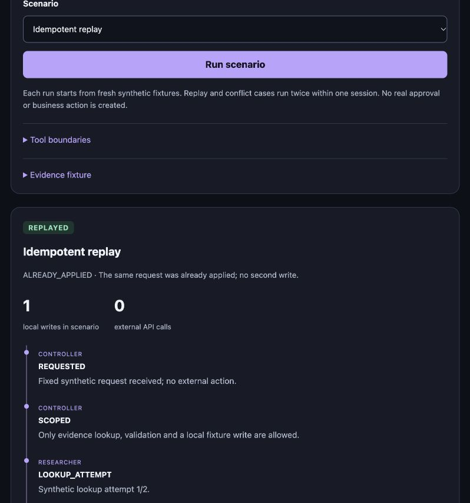

# Evidence-Gated Workflow

**[Try the live synthetic demo](https://tribloc-evidence-workflow.pages.dev/)** — no installation or local server required.

## Hosted browser version

The public site runs the JavaScript browser port, entirely within each visitor's tab. All 11 preset results, including complete traces and payload hashes, were compared with the Python implementation; 12 port tests passed including invalid-scenario refusal. All 11 public browser scenarios were exercised. The Python version below remains runnable locally. No real CRM, LLM or MCP connection is involved.

Build the hosted assets with `npm ci --ignore-scripts` and `npm run build`. The `dist/` output is an explicit static asset set. [Port test report](docs/browser-port-tests.txt).

An independent portfolio demonstration for Benjamin Zsigri, created on 17 October 2026 with AI assistance. This is newly prepared example code, not an extract from Tribloc or evidence of a client deployment.

## Preview



The screenshot is from the local synthetic-data runner. The source below is runnable locally; this repository does not host a live web service.

## Run locally

Requires Python 3.10 or newer. No package installation, account, API key or paid service is needed.

```sh
python3 demo.py --serve
```

Open http://127.0.0.1:8765 in a browser. Keep the terminal running; stop it with Ctrl+C. If the port is occupied, use `python3 demo.py --serve --port 8766` and open that port instead. Opening `index.html` directly does not start the Python backend.

The server listens only on the local loopback address. Do not expose this development server to the internet. No deployment has been performed.

## Reproduce without a browser

```sh
python3 demo.py --scenario approval_required
python3 demo.py --scenario unsupported_claim
python3 demo.py --scenario approved
python3 demo.py --scenario replay
python3 -m unittest -v
```

The browser calls the same `run_scenario` Python function used by the CLI. It does not display prerecorded results.

## Three-minute demonstration

1. **Approval required.** Valid fixture evidence reaches `AWAITING_APPROVAL`; there is no write.
2. **Unsupported claim.** A proposed field value differs from its cited source. The workflow stops with `UNSUPPORTED_CLAIM`; no record is written.
3. **Out-of-scope tool.** An email-send request is denied by the tool allowlist. No message is sent or external tool called.
4. **Approved local write.** The synthetic reviewer supplies the current payload digest. One in-memory fixture record is written.
5. **Idempotent replay.** The same approved request runs twice with a shared in-memory ledger. The second call performs no second write.
6. **Retry limit reached.** A simulated source failure consumes two lookup attempts, then stops before writing.

Expand the actual Python result to show the request, payload digest, evidence, trace, local record and write count.

## What is implemented

- Deterministic role-labelled workflow stages with a tool allowlist.
- Field-to-fixture-source consistency and source-date checks.
- Payload-bound approval checks using SHA-256 of canonical JSON.
- A bounded synthetic retry path.
- An in-memory request ledger rejecting duplicate writes and changed-payload ID reuse.
- A local browser UI, CLI and 16 automated tests.

## What this does not establish

- There are no autonomous agents, LLM calls, MCP server or external integrations. The roles are simulated labels within one Python process.
- All companies, fields and source URLs are fictional fixtures. URLs are never fetched. Matching a fixture does not establish a real-world fact or measure research accuracy.
- The source-date rule uses the fixed reference date 2026-10-17 for reproducibility, not the current clock.
- A synthetic actor and payload hash are not authenticated approval or a cryptographic signature.
- State is in memory and fresh for each scenario. Replay/conflict scenarios share it only across their two internal calls. There is no durable ledger, concurrency control, transaction or crash-recovery guarantee.
- There is no external CRM write, email delivery or production deployment. The local server is a demonstration runner, not a hardened service.
- Passing tests establish only these named examples; they are not an independent audit or a claim of complete security.

## Evidence files

- `fixtures.json`: fictional inputs and source records.
- `sample-results.json`: actual local outputs for all eleven scenarios.
- `test-report.txt`: captured test result.
- `test_demo.py`: reproducible success and rejection checks.

## Suggested public description

> A small, reproducible Python demonstration of evidence consistency checks, bounded tool use, payload-bound approval and duplicate-write prevention. Built with AI assistance for portfolio use, with a local browser interface and synthetic fixtures. It demonstrates control-flow and validation patterns; it is not a production agent platform or a live MCP/CRM integration.

## Project enquiries

[Benjamin Zsigri on Contra](https://contra.com/benjamin_zsigri_g05naerx/services)
